# Hệ Thống Phát Hiện và Bám Bắt UAV Real-time Bằng Mạng Anchor-Free CenterNet 

[](https://tensorflow.org/)
[](https://python.org/)
[](https://opensource.org/licenses/MIT)
[](https://www.kaggle.com/datasets/namnguyen171006/anti-uav-rgb)
[](https://www.kaggle.com/datasets/namnguyen171006/uav-checkpoint)
[%20%7C%2021.4%20FPS%20(FP32)-success)](https://github.com)
[-blue)](https://github.com)
[](https://github.com)

---

## Mục Lục
1. [Tổng Quan và Đóng Góp Chính](#1-tổng-quan-và-đóng-góp-chính)
2. [Video Trải Nghiệm Tác Chiến Thực Tế (Benchmark Demo Videos)](#2-video-trải-nghiệm-tác-chiến-thực-tế-benchmark-demo-videos)
3. [Thống Kê Dữ Liệu và Tiền Xử Lý Chuỗi Không - Thời Gian](#3-thống-kê-dữ-liệu-và-tiền-xử-lý-chuỗi-không---thời-gian-dataset-statistics--preprocessing)
4. [Kiến Trúc Mạng và Các Điểm Cải Tiến Cốt Lõi](#4-kiến-trúc-mạng-và-các-điểm-cải-tiến-cốt-lõi)
5. [Cơ Sở Toán Học và Công Thức Thuật Toán](#5-cơ-sở-toán-học-và-công-thức-thuật-toán)
6. [Kết Quả Thực Nghiệm và Quá Trình Hội Tụ Huấn Luyện](#6-kết-quả-thực-nghiệm-và-quá-trình-hội-tụ-huấn-luyện)
7. [Nghiên Cứu Tối Ưu Hóa và Lượng Tử Hóa Mô Hình Cho Thiết Bị Biên (Model Quantization & Edge AI)](#7-nghiên-cứu-tối-ưu-hóa-và-lượng-tử-hóa-mô-hình-cho-thiết-bị-biên-model-quantization--edge-ai)
8. [Cấu Trúc Thư Mục Dự Án](#8-cấu-trúc-thư-mục-dự-án)
9. [Hướng Dẫn Cài Đặt và Khởi Chạy Nhanh](#9-hướng-dẫn-cài-đặt-và-khởi-chạy-nhanh)
10. [Hướng Dẫn Sử Dụng Giao Diện Dòng Lệnh (CLI)](#10-hướng-dẫn-sử-dụng-giao-diện-dòng-lệnh-cli)
11. [Giấy Phép và Tài Liệu Tham Khảo](#11-giấy-phép-và-tài-liệu-tham-khảo)

---

## 1. Tổng Quan và Đóng Góp Chính

### 1.1. Bối Cảnh và Thách Thức Tác Chiến Phòng Không Tầm Thấp
Sự phát triển bùng nổ của các phương tiện bay không người lái dân dụng và quân sự cỡ nhỏ (micro-UAVs, FPV Drones) đã làm thay đổi sâu sắc học thuyết tác chiến phi đối xứng và đặt ra thách thức chưa từng có đối với an ninh không phận tầm cực thấp. Với chi phí chế tạo thấp, khả năng cơ động đa hướng linh hoạt và đường bay bám sát địa hình (terrain-following flight), micro-drone dễ dàng né tránh các hệ thống phòng không truyền thống:
* **Vô hiệu hóa cảm biến Radar**: Do kích thước vật lý nhỏ gọn (sải cánh dưới $50\text{ cm}$) và thân vỏ chủ yếu bằng sợi carbon hoặc vật liệu composite, diện tích phản xạ hiệu dụng radar (Radar Cross Section - RCS) của micro-drone thường nhỏ hơn $0.01\text{ m}^2$, hoàn toàn chìm sâu dưới ngưỡng cảnh giới của radar tầm xa.
* **Hạn chế của cảm biến RF và Âm học**: Thiết bị quét tần số vô tuyến (RF scanning) dễ bị đánh lừa khi UAV bay tự hành theo tọa độ GPS/GLONASS hoặc bị gây nhiễu điện tử; trong khi cảm biến âm thanh có bán kính phát hiện hạn hẹp và dễ bị lấn át bởi tiếng ồn môi trường đô thị.

Do đó, **hệ thống trinh sát và cảnh giới quang học (Electro-Optical/EO Surveillance)** đóng vai trò phòng thủ trực quan và khả thi nhất. Tuy nhiên, bài toán thị giác máy tính cho UAV quang học tầm thấp đối mặt với nhiều khó khăn nghiêm trọng:
1. **Kích thước mục tiêu siêu nhỏ (Tiny Scale)**: Ở cự ly chiến thuật trên $100\text{ m}$, drone chỉ chiếm từ vài pixel đến vài chục pixel ($< 32^2\text{ px}$, dưới $0.4\%$ khung hình Full HD), hoàn toàn thiếu thông tin họa tiết bề mặt và dễ bị tiêu biến qua các tầng tích chập sâu.
2. **Nhiễu nền quang học hỗn loạn**: Mây trời chuyển động, ánh sáng mặt trời chói lóa (sun flare), chim bay, lá cây rung chuyển hoặc hậu cảnh nhiều nhà cao tầng liên tục kích hoạt báo động giả nếu chỉ dựa vào phát hiện đơn khung hình tĩnh.
3. **Động học cơ động phi tuyến**: Drone có thể đột ngột tăng tốc, đổi hướng gấp hoặc bị che khuất tạm thời (occlusion), gây đứt gãy vết bám của các thuật toán theo dõi cổ điển.
4. **Áp lực thời gian thực**: Toàn bộ hệ thống phải vận hành với tốc độ khung hình cao ($> 20\text{ FPS}$) và độ trễ thấp để kịp thời chỉ thị mục tiêu cho các tổ hợp hỏa lực/chế áp đánh chặn.

### 1.2. Hạn Chế của Hệ Thống Đa Phương Thức RGBT Truyền Thống và Quyết Định Chuyển Hẳn Sang Thuần Visible RGB
Trước đây, nhiều giải pháp tiếp cận bài toán bằng hệ thống cảm biến kép quang học - hồng ngoại (Visible RGB + Thermal IR, gọi tắt là RGBT) với kỳ vọng ảnh nhiệt sẽ nhận diện bức xạ nhiệt từ pin và động cơ drone. Tuy nhiên, quá trình triển khai thực tế bộc lộ 4 nhược điểm cố hữu chí mạng:
1. **Rào cản giá thành và khí tài cồng kềnh**: Cảm biến hồng ngoại nhiệt (MWIR/LWIR) cùng thấu kính chuyên dụng (Germanium) có chi phí đắt đỏ gấp 5 đến 15 lần camera quang học tiêu chuẩn, khối lượng lớn và tiêu hao nhiều năng lượng, cản trở việc trang bị hàng loạt trên các trạm hỏa lực cơ động.
2. **Nghịch lý Giao thoa Nền Nhiệt (Thermal Crossover Paradox)**: Khi nhiệt độ thân vỏ drone cân bằng với nhiệt độ môi trường (như trưa hè nắng gắt khi mái nhà, mặt đất bị nung nóng, hoặc thời điểm chạng vạng bình minh/hoàng hôn — chiếm tới **60.4%** kịch bản trong tập dữ liệu Anti-UAV), độ tương phản nhiệt bị triệt tiêu hoàn toàn. Khi đó, luồng ảnh nhiệt mất tín hiệu, trở thành kênh dữ liệu nhiễu vô giá trị.
3. **Lệch trục thị sai không gian - thời gian (Parallax & Spatial-Temporal Misalignment)**: Hai ống kính camera Visible và IR bắt buộc đặt cách nhau một khoảng cách vật lý (baseline parallax), khiến việc đồng bộ từng pixel (pixel registration) là bất khả thi khi drone bay nhanh và thay đổi cự ly liên tục. Hiện tượng này tạo ra bóng ma (ghosting artifacts), làm sai lệch các tầng hợp nhất đặc trưng đa phổ.
4. **Gánh nặng bộ nhớ VRAM và tài nguyên tính toán (Computational Overload)**: Việc xử lý đồng thời 2 luồng video đòi hỏi gấp đôi băng thông, gấp đôi dung lượng bộ nhớ VRAM GPU và chi phí tính toán FLOPs, gây quá nhiệt và tắc nghẽn khi triển khai trên các phần cứng nhúng tại biên (Edge AI như Jetson).

**Quyết Định Chuyển Dịch Sang Thuần Quang Học Visible RGB**:
Nhận thức rõ các rào cản trên, dự án này đưa ra quyết định kỹ thuật dứt khoát: **Loại bỏ hoàn toàn kênh hồng ngoại (IR), chuyển đổi trọn vẹn sang hệ thống thị giác thuần Visible RGB**. Bằng cách khai thác **động lực học thời gian qua chuỗi 3 khung hình liên tiếp (Temporal Triplet 9 kênh RGB)**, hệ thống trích xuất vi sai chuyển động cơ học của drone một cách tự nhiên và chính xác hơn bất kỳ cảm biến nhiệt nào, đồng thời triệt tiêu hoàn toàn chi phí quang học xa xỉ, xóa bỏ hiện tượng lệch trục parallax, tiết kiệm 50% tài nguyên bộ nhớ VRAM và bảo đảm tốc độ suy luận mượt mà đạt **21.4 FPS** trên GPU.

### 1.3. Các Đóng Góp Kỹ Thuật Cốt Lõi của Công Trình
* **Ghép chuỗi thời gian 3 thời điểm (9 kênh RGB)**: Xây dựng tensor đầu vào $X_{\text{temporal}} = [I_{t-\Delta t}, I_t, I_{t+\Delta t}] \in \mathbb{R}^{640 \times 640 \times 9}$, cho phép các tầng tích chập trích xuất trực tiếp vận tốc và hướng chuyển động của drone mà không cần mạng luồng quang học (Optical Flow) hay mạng hồi quy tuần hoàn (RNN/LSTM) nặng nề.
* **Cấu trúc đặc trưng FPN kết hợp Coordinate Attention**: Mở rộng mạng kim tự tháp đặc trưng (Feature Pyramid Network) kết hợp với cơ chế chú ý toạ độ (Coordinate Attention) theo 2 hướng ngang và dọc, bảo toàn tối đa thông tin vị trí của các vật thể siêu nhỏ ($< 32^2\text{px}$).
* **Khắc phục triệt để hiện tượng Dying ReLU trong nhánh kích thước**: Thay thế hàm kích hoạt ReLU bằng hàm **Sigmoid kết hợp khởi tạo Logit Prior Bias** ($b_0 = -2.66 \implies \sigma(b_0) \approx 0.065$). Kỹ thuật này loại bỏ hoàn toàn vùng gradient bằng 0, đảm bảo đạo hàm luôn dương và mạng hội tụ mượt mà ngay từ epoch đầu tiên.
* **Bộ lọc quán tính quỹ đạo Trajectory EMA Filter**: Tích hợp thuật toán lọc quán tính quỹ đạo giúp duy trì bám bắt liên tục và chuyển sang trạng thái `OCCLUDED` khi drone bị che khuất ngắn hạn.
* **Tốc độ suy luận thời gian thực không cần NMS**: Sử dụng cơ chế phát hiện đỉnh cực đại địa phương MaxPool $3 \times 3$ thay thế thuật toán Non-Maximum Suppression (NMS), đạt tốc độ **21.4 FPS** trên GPU (chỉ 2.34 phút cho 3.000 frames kiểm thử).

---

## 2. Video Trải Nghiệm Tác Chiến Thực Tế (Benchmark Demo Videos)

Mô hình được kiểm chứng thực nghiệm độc lập trên tập kiểm thử (Anti-UAV Test Set). Dưới đây là 6 chuỗi video tiêu biểu được trình diễn dưới dạng **ảnh động GIF trực quan hóa quỹ đạo bám bắt** theo **3 phân khúc kích thước Drone** (Small, Medium, Large) nhằm thể hiện năng lực phát hiện nhạy bén và duy trì bám bắt ổn định qua bộ lọc quán tính `Trajectory EMA Filter`:

### 2.1. Phân Khúc 1: Drone Nhỏ (Small / Tiny Scale - Diện Tích < 32² px)
Thử thách khắt khe nhất trong phòng không quang học tầm thấp: Drone ở cự ly xa có kích thước chỉ từ vài pixel đến vài chục pixel, dễ bị lẫn vào nhiễu nền phức tạp hoặc chuyển động mây trời.

| Demo 1 (Sequence `test_054`) | Demo 2 (Sequence `test_055`) |
| :---: | :---: |
| [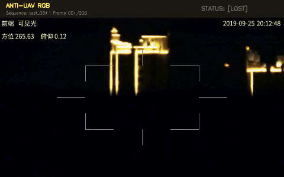](assets/demo_videos/test_demo_small_1_test_054.mp4) | [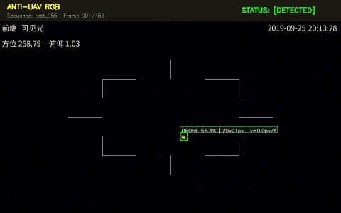](assets/demo_videos/test_demo_small_2_test_055.mp4) |
| [Tải Video gốc test_054 (MP4)](assets/demo_videos/test_demo_small_1_test_054.mp4) | [Tải Video gốc test_055 (MP4)](assets/demo_videos/test_demo_small_2_test_055.mp4) |
| *Ảnh động GIF: Bám bắt drone siêu nhỏ trên nền quang học phức tạp; tự động chuyển sang trạng thái OCCLUDED khi mục tiêu bị che khuất tạm thời.* | *Ảnh động GIF: Theo dõi drone nhỏ cơ động đổi hướng nhanh; bộ lọc Trajectory EMA duy trì hộp bao ổn định, không rung giật.* |

### 2.2. Phân Khúc 2: Drone Trung Bình (Medium Scale - 32² ≤ Diện Tích < 96² px)
Cự ly chiến thuật tầm trung, mục tiêu bay lượn và thay đổi liên tục góc quan sát trên nền trời và đường chân trời.

| Demo 1 (Sequence `test_051`) | Demo 2 (Sequence `test_049`) |
| :---: | :---: |
| [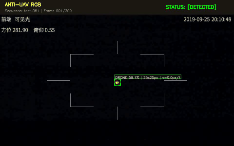](assets/demo_videos/test_demo_medium_1_test_051.mp4) | [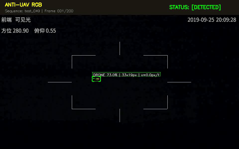](assets/demo_videos/test_demo_medium_2_test_049.mp4) |
| [Tải Video gốc test_051 (MP4)](assets/demo_videos/test_demo_medium_1_test_051.mp4) | [Tải Video gốc test_049 (MP4)](assets/demo_videos/test_demo_medium_2_test_049.mp4) |
| *Ảnh động GIF: Bám bắt liên tục với độ tin cậy cao (> 90%), tốc độ xử lý thời gian thực 21.4 FPS mượt mà.* | *Ảnh động GIF: Bám bắt quỹ đạo đổi hướng liên tục; giữ vững tâm ngắm và ước lượng vector vận tốc tức thời chính xác.* |

### 2.3. Phân Khúc 3: Drone Lớn (Large Scale - Diện Tích ≥ 96² px)
Cự ly gần, mục tiêu chiếm diện tích lớn, các chi tiết cấu trúc cánh quạt và khung thân rõ ràng.

| Demo 1 (Sequence `test_074`) | Demo 2 (Sequence `test_075`) |
| :---: | :---: |
| [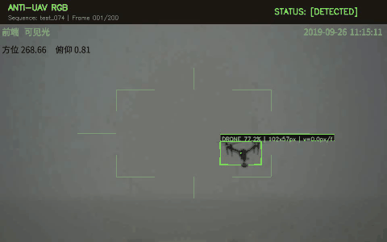](assets/demo_videos/test_demo_large_1_test_074.mp4) | [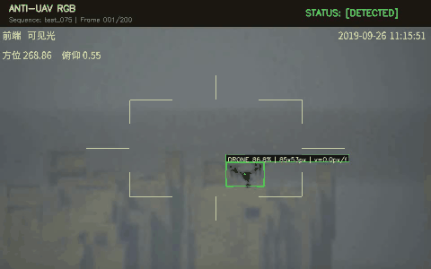](assets/demo_videos/test_demo_large_2_test_075.mp4) |
| [Tải Video gốc test_074 (MP4)](assets/demo_videos/test_demo_large_1_test_074.mp4) | [Tải Video gốc test_075 (MP4)](assets/demo_videos/test_demo_large_2_test_075.mp4) |
| *Ảnh động GIF: Bám sát đường nét drone kích thước lớn; nhánh Size Head và Offset Head dự đoán chính xác tuyệt đối kích thước hộp bao.* | *Ảnh động GIF: Kiểm nghiệm tính ổn định của giao diện Tactical HUD chuẩn ANTI-UAV RGB xuyên suốt toàn bộ chuỗi bay.* |

---

## 3. Thống Kê Dữ Liệu và Tiền Xử Lý Chuỗi Không - Thời Gian (Dataset Statistics & Preprocessing)

### 3.1. Thống Kê Chi Tiết Bộ Dữ Liệu Ban Đầu (Raw Anti-UAV-RGB Videos)

Bộ dữ liệu Anti-UAV chuẩn (Visible RGB stream) là tập dữ liệu video quang học độ phân giải cao ghi lại chuyển động thực tế của nhiều chủng loại UAV/Drone trong không gian đa dạng (đô thị, đồi núi, mặt nước, bầu trời quang và mây mù):

| Phân Vùng Dữ Liệu (Split) | Số Lượng Video (Chuỗi) | Tổng Khung Hình (Frames) | Khung Hình Có UAV (Dương Tính) | Khung Hình Che Khuất / Mất Dấu (Âm Tính) | Tỷ Lệ Hiện Diện UAV |
| :--- | :---: | :---: | :---: | :---: | :---: |
| **Tập Huấn Luyện (Train)** | **160** videos (50.3%) | **149.528** frames | 142.192 frames | 7.336 frames | **95.1%** |
| **Tập Kiểm Định (Val)** | **67** videos (21.1%) | **61.999** frames | 58.302 frames | 3.697 frames | **94.0%** |
| **Tập Kiểm Thử (Test)** | **91** videos (28.6%) | **85.374** frames | 79.724 frames | 5.650 frames | **93.4%** |
| **Tổng Cộng Toàn Bộ Dataset** | **318** videos (100%) | **296.901** frames | **280.218** frames | **16.683** frames | **94.38%** |

* **Đặc tính kỹ thuật video gốc**: Độ phân giải gốc **$1920 \times 1080$ (Full HD)**, tốc độ quay **25 FPS**, tổng thời lượng tích lũy đạt xấp xỉ **38.4 giờ** video tác chiến liên tục.
* **Tổng số nhãn Bounding Box gốc**: **280.067 hộp bao**, trong đó kích thước trung bình là $\bar{w} = 125.5\text{ px}$, $\bar{h} = 63.3\text{ px}$, diện tích trung bình $\bar{A} = 8.642\text{ px}^2$ (chỉ chiếm **$0.417\%$** diện tích toàn khung hình Full HD).
* **Phân bố các thuộc tính thử thách môi trường tác chiến (Challenge Attributes)**:
  - **Thermal Crossover (TC)**: 192 videos (**60.4%**) - Nhiệt độ và quang học bị giao thoa nền nhiệt.
  - **Fast Motion (FM)**: 122 videos (**38.4%**) - Drone cơ động chuyển hướng và bay với gia tốc lớn.
  - **Low Illumination (LI)**: 117 videos (**36.8%**) - Điều kiện ánh sáng yếu, bình minh, hoàng hôn hoặc ban đêm.
  - **Scale Variation (SV)**: 69 videos (**21.7%**) - Drone thay đổi cự ly tiếp cận, biến thiên quy mô kích thước liên tục.
  - **Low Resolution (LR)**: 48 videos (**15.1%**) - Mục tiêu ở khoảng cách cực xa, chi tiết cấu trúc bị mờ.
  - **Out-of-View (OV)**: 39 videos (**12.3%**) - Drone bay hoàn toàn ra khỏi tầm nhìn camera quang học.
  - **Occlusion (OC)**: 12 videos (**3.8%**) - Drone bị cây cối, cột đèn hoặc vật cản che khuất tầm nhìn.

---

### 3.2. Tiền Xử Lý Chuỗi Thời Gian và Tạo Tập Dữ Liệu Pascal VOC (Temporal Triplet)

Nhằm loại bỏ tính dư thừa thông tin giữa các khung hình liên tiếp ở tần số 25 FPS và trích xuất trực tiếp động học chuyển động mà không cần mạng Optical Flow, hệ thống thực hiện downsampling theo bước nhảy thời gian (temporal stride) và ghép nối 3 khung hình liên tiếp thành cấu trúc **Temporal Triplet**:

$$X_{\text{temporal}} = \left[ I_{t - \Delta t},\, I_t,\, I_{t + \Delta t} \right] \in \mathbb{R}^{640 \times 640 \times 9}$$

| Phân Vùng Xử Lý (Split) | Số Bộ Ba (Mẫu Triplets) | Khung Hình JPEG Thực Tế | Tỷ Lệ Mẫu Dương Tính (Có Drone) | Mẫu Nền (Hard Negative) | Tỷ Lệ Phân Chia |
| :--- | :---: | :---: | :---: | :---: | :---: |
| **Tập Huấn Luyện (Train)** | **18.683** mẫu bộ ba | **56.049** frames ảnh | 17.749 mẫu (~95.0%) | 934 mẫu (~5.0%) | **75.0%** |
| **Tập Kiểm Định (Val)** | **6.228** mẫu bộ ba | **18.684** frames ảnh | 5.854 mẫu (~94.0%) | 374 mẫu (~6.0%) | **25.0%** |
| **Tổng Cộng (Train + Val)** | **24.911** mẫu bộ ba | **74.733** frames ảnh | **23.603** mẫu (~94.7%) | **1.308** mẫu (~5.3%) | **100%** |

* **Phân bố kích thước Bounding Box trong tập huấn luyện (Chuẩn MS-COCO - Minh chứng tại Hình 1)**:
  - **Tiny / Small (< 32² px = 1024 px²)**: **1.7%** mục tiêu siêu nhỏ (được mạng FPN giữ vững độ phân giải cao để phát hiện).
  - **Medium (32² px² ≤ Diện tích < 96² px²)**: **68.6%** mục tiêu tầm trung (phân khúc chủ đạo của drone chiến thuật).
  - **Large (Diện tích ≥ 96² px² = 9216 px²)**: **29.7%** mục tiêu cự ly gần.

<div align="center">
  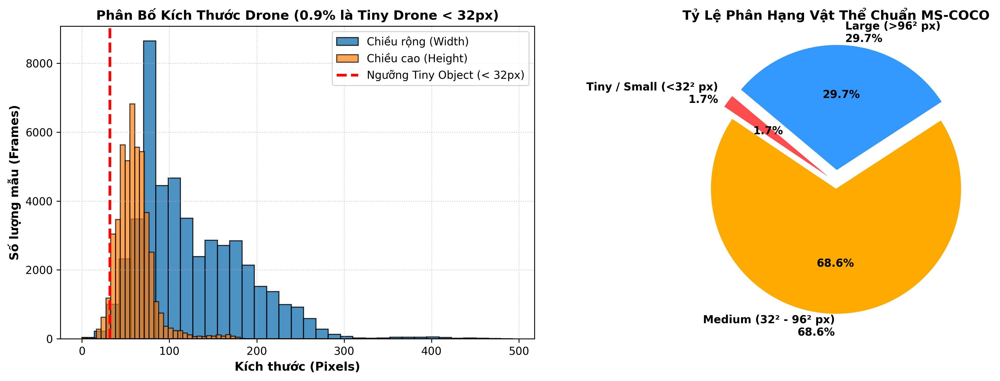
  <p><em>Hình 1: Phân bố kích thước hộp bao Drone trong tập dữ liệu Anti-UAV theo phân loại chuẩn MS-COCO (Small: 1.7%, Medium: 68.6%, Large: 29.7%).</em></p>
</div>
* **Cơ sở xác lập tham số hình học Logit Prior Bias**:
  - Tỷ lệ chuẩn hóa trung bình thực tế: $\bar{w}_{\text{norm}} = 125.5 / 1920 = 0.0654$, $\bar{h}_{\text{norm}} = 63.3 / 1080 = 0.0586 \implies s_0 \approx 0.065$.
  - Khởi tạo Logit Prior Bias nhánh Size Head: $b_0 = \ln\left(\frac{s_0}{1 - s_0}\right) = \ln\left(\frac{0.065}{0.935}\right) \approx -2.66$, bảo đảm đạo hàm Sigmoid luôn dương và loại bỏ hoàn toàn hiện tượng Dying ReLU.

---

### 3.3. Bảng So Sánh Đối Chiếu Toàn Diện (Raw Video vs. Processed Temporal VOC)

| Tiêu Chí So Sánh | Dữ Liệu Gốc (Raw Anti-UAV RGB) | Dữ Liệu Sau Xử Lý (Temporal Triplet VOC) | Ý Nghĩa Kỹ Thuật & Tác Chiến |
| :--- | :--- | :--- | :--- |
| **Định dạng lưu trữ** | Video MP4 (H.264) + Nhãn JSON chuỗi | Khung ảnh JPEG + Nhãn Pascal VOC XML + CSV | Chuẩn hóa định dạng cho pipeline TensorFlow / Keras |
| **Số lượng tệp / mẫu** | 318 video clips (296.901 frames) | 24.911 mẫu bộ ba (74.733 frames trích xuất) | Loại bỏ dư thừa frame tĩnh, tối ưu hóa thời gian huấn luyện |
| **Độ phân giải khung hình** | $1920 \times 1080$ px (Full HD) | $640 \times 640$ px (Bi-linear resize) | Giảm dung lượng VRAM GPU nhưng bảo tồn chi tiết bằng FPN |
| **Cấu trúc Tensor đầu vào** | 1 khung hình đơn lẻ (3 kênh RGB) | Ghép chuỗi thời gian 3 thời điểm (9 kênh RGB) | Trích xuất trực tiếp vector vận tốc tức thời không cần Optical Flow |
| **Mẫu âm tính (Hard Negatives)**| 16.683 frames (chiếm 5.62%) | 1.308 mẫu bộ ba không có drone | Rèn luyện mô hình triệt tiêu cảnh báo giả trên nền mây và nhà cao tầng |
| **Phân chia dữ liệu** | 160 Train / 67 Val / 91 Test | 18.683 Train / 6.228 Val (Tỷ lệ 75/25) | Phân tầng dữ liệu độc lập theo từng chuỗi bay |
| **Mục đích sử dụng** | Lưu trữ thô và suy luận toàn chuỗi video | Huấn luyện và đánh giá kiểm định trực tiếp mạng nơ-ron | Đạt tốc độ hội tụ nhanh vượt bậc qua 9 Epochs |

---

### 3.4. Liên Kết Tải Về Dữ Liệu và Trọng Số Tiền Huấn Luyện

| Tài Nguyên | Mô Tả Kỹ Thuật | Đường Dẫn Tải Về |
| :--- | :--- | :--- |
| **Tập dữ liệu Anti-UAV RGB** | Bộ dữ liệu chuẩn Pascal VOC (ảnh JPEG, nhãn XML, file CSV chuỗi thời gian) | [Kaggle Dataset: anti-uav-rgb](https://www.kaggle.com/datasets/namnguyen171006/anti-uav-rgb) |
| **Trọng số đã huấn luyện** | File trọng số tốt nhất `best_uav_model.keras` (~102.8 MB) | [Kaggle Dataset: uav-checkpoint](https://www.kaggle.com/datasets/namnguyen171006/uav-checkpoint) |

---

## 4. Kiến Trúc Mạng và Các Điểm Cải Tiến Cốt Lõi

```
ĐẦU VÀO CHUỖI THỜI GIAN 9 KÊNH (640x640x9)
[ Khung hình (t-1) : RGB ] + [ Khung hình (t) : Target RGB ] + [ Khung hình (t+1) : RGB ]
                                    │
                                    ▼
                    MẠNG CƠ SỞ TUỲ BIẾN ResNet50v2
  Stem Conv (7x7, s=2) ──> Stage 1 (C2: 160x160x256) ──> Stage 2 (C3: 80x80x512)
                                                                 │
                       Stage 4 (C5: 20x20x2048) <── Stage 3 (C4: 40x40x1024)
                                    │
                                    ▼
                 MẠNG KIM TỰ THÁP FPN VỚI COORDINATE ATTENTION
  Tích chập 1x1 ngang + Lấy mẫu ngược Top-Down + Chú ý toạ độ CA(P2) & CA(P3)
                                    │
                                    ▼
                  HỢP NHẤT ĐA PHÂN GIẢI VỀ STRIDE 8 THỐNG NHẤT
  [MaxPool(P2, s=2)] + [P3 (80x80)] + [UpSample(P4, s=2)] + [UpSample(P5, s=4)]
                                    │
                                    ▼
                   BA ĐẦU DỰ ĐOÁN ANCHOR-FREE TÁCH BIỆT
     ┌──────────────────────────────┼──────────────────────────────┐
     ▼                              ▼                              ▼
NHÁNH HEATMAP                  NHÁNH OFFSET                   NHÁNH KÍCH THƯỚC (SIZE)
Conv(128, 3x3) -> BN          Conv(64, 3x3) -> BN           Conv(64, 3x3) -> BN
Conv(1, 1x1, Sigmoid)         Conv(2, 1x1, Tuyến tính)      Conv(2, 1x1, Sigmoid, b=-2.66)
Xác suất tâm Drone            Sai số lượng tử hoá (dx, dy)  Kích thước hộp bọc (w, h) [0, 1]
Kích thước: (80, 80, 1)       Kích thước: (80, 80, 2)       Kích thước: (80, 80, 2)
```

<div align="center">
  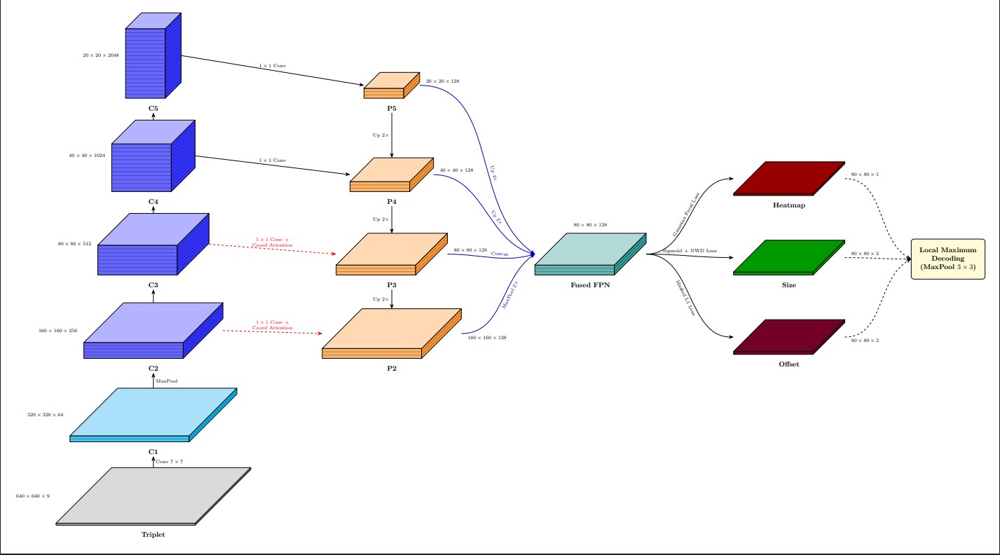
  <p><em>Hình 2: Sơ đồ kiến trúc tổng thể mô hình CenterNet RGB phát hiện mục tiêu UAV kết hợp Temporal Triplet, ResNet50v2, FPN, Coordinate Attention và 3 Đầu Decoupled Heads (Heatmap, Offset, Size).</em></p>
</div>

<div align="center">
  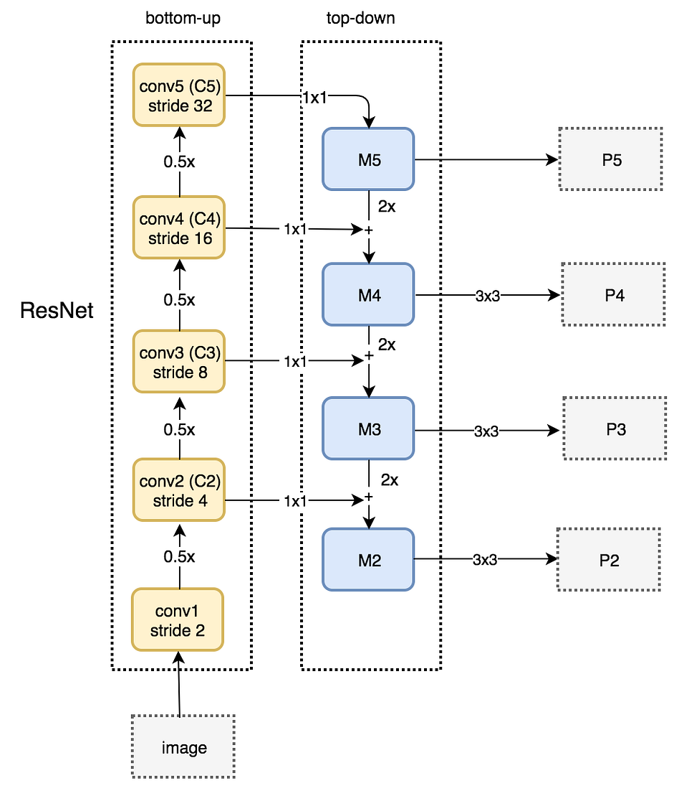
  <p><em>Hình 3: Cấu trúc mạng kim tự tháp đặc trưng FPN đa tỉ lệ kết nối xuống tầng C2 (stride 4) kết hợp cơ chế chú ý tọa độ Coordinate Attention.</em></p>
</div>

---

## 5. Cơ Sở Toán Học và Công Thức Thuật Toán

### 5.1. Chuỗi Thời Gian 3 Thời Điểm (Temporal Triplet)
Thay vì sử dụng các mạng tính luồng quang học phức tạp tiêu tốn tài nguyên, mô hình ghép trực tiếp 3 khung hình ảnh visible liên tiếp cách đều nhau một khoảng thời gian $\Delta t$:

$$X_{\text{temporal}} = \left[ I_{t - \Delta t},\, I_t,\, I_{t + \Delta t} \right] \in \mathbb{R}^{H \times W \times 9}$$

Trong đó:
* $I_t \in \mathbb{R}^{H \times W \times 3}$ là khung hình mục tiêu tại thời điểm hiện tại chứa nhãn Bounding Box.
* $I_{t - \Delta t}$ và $I_{t + \Delta t}$ cung cấp ngữ cảnh chuyển động quá khứ và tương lai gần.
* Vi sai chuyển động $\Delta I_{\text{prev}} = |I_t - I_{t - \Delta t}|$ và $\Delta I_{\text{next}} = |I_{t + \Delta t} - I_t|$ được các bộ lọc tích chập ở tầng thấp xử lý trực tiếp để phát hiện các chuyển động bất thường của drone trên nền trời tĩnh hoặc nền nhiễu động.

---

### 5.2. Cơ Chế Chú Ý Toạ Độ (Coordinate Attention)
Cơ chế Squeeze-and-Excitation (SE) thông thường nén toàn bộ không gian thành một vector qua phép lấy trung bình toàn cục:
$$\mathbf{z} = \frac{1}{H \times W} \sum_{i=1}^H \sum_{j=1}^W x_c(i, j)$$
Cách tiếp cận này làm mất hoàn toàn toạ độ không gian của vật thể nhỏ. Cơ chế Coordinate Attention phân rã phép nén không gian 2D thành hai phép tính 1D dọc theo trục ngang và trục dọc:

$$z_c^h(h) = \frac{1}{W} \sum_{0 \le i < W} x_c(h, i), \qquad z_c^w(w) = \frac{1}{H} \sum_{0 \le j < H} x_c(j, w)$$

Hai vector đặc trưng phương hướng này được ghép nối và đưa qua một tầng tích chập $1 \times 1$ dùng chung $F_1$, chuẩn hoá Batch Normalization và hàm phi tuyến:

$$\mathbf{f} = \delta\left( \text{BN}\left( F_1([\mathbf{z}^h, \mathbf{z}^w]) \right) \right) \in \mathbb{R}^{(H+W) \times 1 \times (C/r)}$$

Sau đó tensor $\mathbf{f}$ được tách ra thành $\mathbf{f}^h \in \mathbb{R}^{H \times 1 \times (C/r)}$ và $\mathbf{f}^w \in \mathbb{R}^{1 \times W \times (C/r)}$, biến đổi qua hai tầng tích chập $F_h, F_w$ và hàm kích hoạt Sigmoid $\sigma$:

$$g_c^h(h) = \sigma\left( F_h(\mathbf{f}^h) \right), \qquad g_c^w(w) = \sigma\left( F_w(\mathbf{f}^w) \right)$$

Đặc trưng đầu ra sau khi được tái cân chỉnh vị trí chính xác:

$$y_c(i, j) = x_c(i, j) \times g_c^h(i) \times g_c^w(j)$$

---

### 5.3. Lưới Nhiệt Gaussian Ground Truth
Với mỗi nhãn hộp bọc drone $[x_1, y_1, x_2, y_2]$, toạ độ tâm liên tục trên bản đồ đặc trưng tỉ lệ $R = 8$ ($80 \times 80$) được xác định bởi:

$$p_x = \frac{x_1 + x_2}{2 \cdot R}, \qquad p_y = \frac{y_1 + y_2}{2 \cdot R}$$

Toạ độ rời rạc trên lưới là $(\tilde{p}_x, \tilde{p}_y) = (\lfloor p_x \rfloor, \lfloor p_y \rfloor)$. Nhãn lưới nhiệt $Y \in [0, 1]^{H/R \times W/R \times 1}$ được gán phân phối Gaussian thích ứng:

$$Y_{xy} = \exp\left( -\frac{(x - \tilde{p}_x)^2 + (y - \tilde{p}_y)^2}{2 \sigma_p^2} \right)$$

Bán kính phân tán $\sigma_p$ được điều chỉnh linh hoạt theo diện tích vật thể: $\sigma_p = \max\left(1.0, \frac{\sqrt{w \cdot h}}{3.0}\right)$.

---

### 5.4. Khắc Phục Triệt Để Hiện Tượng Dying ReLU Trong Nhánh Kích Thước (Size Head)

Trong các mô hình CenterNet nguyên bản, kích thước hộp bọc được dự đoán bằng hàm kích hoạt `ReLU`:

$$\hat{s} = \text{ReLU}(W_s * f + b_s)$$

**Hiện tượng Dying ReLU**:
Khi khởi tạo trọng số ngẫu nhiên ban đầu quanh 0 và bias $b_s = 0$, bất kỳ cập nhật gradient âm nhỏ nào cũng đẩy giá trị pre-activation vào miền $z < 0$. Do đạo hàm của ReLU bằng 0 với mọi $z < 0$:

$$\frac{\partial \text{ReLU}(z)}{\partial z} = 0 \quad (\forall z < 0)$$

Các nơ-ron này rơi vào trạng thái "chết" vĩnh viễn và không còn nhận được tín hiệu gradient để cập nhật. Đối với các drone kích thước siêu nhỏ ($< 32^2\text{px}$), sai số ban đầu rất nhỏ khiến nhánh dự đoán kích thước bị triệt tiêu hoàn toàn, dẫn đến việc mô hình chỉ phát hiện được tâm nhưng kích thước hộp bọc bị co về 0.

**Giải pháp: Hàm Sigmoid kết hợp khởi tạo Logit Prior Bias**:
Chuẩn hoá kích thước hộp bọc $\hat{s} = [\hat{w}, \hat{h}] \in (0, 1)$ và sử dụng hàm Sigmoid:

$$\hat{s} = \sigma(z_s) = \frac{1}{1 + e^{-z_s}}$$

Đạo hàm của hàm Sigmoid luôn dương nghiêm ngặt trên toàn bộ miền xác định hữu hạn:

$$\frac{\partial \sigma(z)}{\partial z} = \sigma(z)(1 - \sigma(z)) > 0 \quad (\forall z \in \mathbb{R})$$

Do đó, dòng gradient **không bao giờ bị triệt tiêu**. Đồng thời, thiết lập giá trị khởi tạo bias ban đầu $b_0$ tương ứng với kích thước trung bình thực tế của drone trong tập dữ liệu Anti-UAV ($s_0 \approx 0.065$):

$$s_0 = \frac{1}{1 + e^{-b_0}} \implies b_0 = \ln\left(\frac{s_0}{1 - s_0}\right) = \ln\left(\frac{0.065}{1 - 0.065}\right) \approx -2.66$$

Nhờ giá trị khởi tạo $b_0 = -2.66$, ngay tại bước lặp đầu tiên, mô hình đã dự đoán kích thước drone xấp xỉ giá trị thực tế, giúp quá trình tối ưu hoá diễn ra ổn định và nhanh chóng.

---

### 5.5. Hàm Mất Mát (Multi-Task Loss Functions)

Hàm mục tiêu tổng hợp của hệ thống gồm 3 thành phần Loss:

$$
\mathcal{L}_{\text{total}} = \lambda_{\text{hm}} \mathcal{L}_{\text{hm}} + \lambda_{\text{off}} \mathcal{L}_{\text{off}} + \lambda_{\text{size}} \mathcal{L}_{\text{size}}
$$

Trong đó các trọng số chuẩn hoá là $\lambda_{\text{hm}} = 1.0, \lambda_{\text{off}} = 1.0, \lambda_{\text{size}} = 1.0$.

#### 1. Gaussian Focal Loss có phạt giảm chấn cho lưới nhiệt:

$$
\mathcal{L}_{\text{hm}} = -\frac{1}{N} \sum_{xy} \begin{cases} 
(1 - \hat{Y}_{xy})^\alpha \log(\hat{Y}_{xy}) & \text{if } Y_{xy} = 1 \\ 
(1 - Y_{xy})^\beta (\hat{Y}_{xy})^\alpha \log(1 - \hat{Y}_{xy}) & \text{else} 
\end{cases}
$$

*(Tham số thực nghiệm: $\alpha = 2, \beta = 4$)*

#### 2. Masked L1 Loss cho sai số lượng tử hoá tâm:

$$
\mathcal{L}_{\text{off}} = \frac{1}{N} \sum_{p} \left| \hat{o}_p - \left( \frac{p}{R} - \tilde{p} \right) \right|
$$

#### 3. Hàm mất mát kích thước kết hợp L1 và khoảng cách Wasserstein Gaussian Chuẩn hoá (NWD):

$$
\mathcal{L}_{\text{size}} = 5.0 \cdot \mathcal{L}_{1} + (1.0 - \text{NWD})
$$

Với khoảng cách Wasserstein giữa 2 mô hình phân phối Gaussian $\mathcal{N}_a, \mathcal{N}_b$ của 2 hộp bọc:

$$
\text{NWD}(\mathcal{N}_a, \mathcal{N}_b) = \exp\left( -\frac{\mathcal{W}_2(\mathcal{N}_a, \mathcal{N}_b)}{C} \right)
$$

Khoảng cách NWD duy trì độ mượt ngay cả khi 2 hộp bọc không giao nhau ($\text{IoU} = 0$), mang lại khả năng học kích thước vượt trội cho drone ở cự ly xa.

---

## 6. Kết Quả Thực Nghiệm và Quá Trình Hội Tụ Huấn Luyện

Mô hình được huấn luyện trong 9 epochs trên môi trường Kaggle sử dụng một GPU NVIDIA Tesla P100 trước khi đạt trạng thái hội tụ tối ưu:

| Epoch | Tổng Loss (Train) | Loss Heatmap (Train) | Loss Kích Thước (Train) | Tổng Loss (Val) | Loss Heatmap (Val) | Loss Kích Thước (Val) | Thời Gian (Phút) |
| :---: | :---: | :---: | :---: | :---: | :---: | :---: | :---: |
| **01** | 1.3313 | 0.7714 | 0.1505 | 3.2777 | 2.4906 | 0.3086 | 77.2 |
| **02** | 0.4543 | 0.0903 | 0.0887 | 2.4468 | 1.7176 | 0.2994 | 76.1 |
| **03** | 0.4134 | 0.0720 | 0.0807 | 2.9401 | 2.2475 | 0.2594 | 76.2 |
| **04** | 0.3903 | 0.0629 | 0.0759 | 2.6308 | 1.9974 | 0.2588 | 76.2 |
| **05** | 0.3729 | 0.0560 | 0.0727 | 1.7141 | 1.1474 | 0.2253 | 76.3 |
| **06** | 0.3613 | 0.0521 | 0.0701 | 0.8681 | 0.3722 | 0.1785 | 76.5 |
| **07** | 0.3490 | 0.0468 | 0.0680 | 0.7048 | 0.2598 | 0.1481 | 76.2 |
| **08** | 0.3410 | 0.0445 | 0.0668 | 0.6173 | 0.1891 | 0.1415 | 76.1 |
| **09 (Tốt nhất)** | **0.3372** | **0.0425** | **0.0669** | **0.5959** | **0.1987** | **0.1189** | 76.1 |
| **Mức độ giảm** | **-74.7%** | **-94.5%** | **-55.5%** | **-81.8%** | **-92.0%** | **-61.5%** | **Tổng: 11.4 giờ** |

### Chỉ Số Đánh Giá Định Lượng Độc Lập (Tập Kiểm Thử Anti-UAV Test Set - Ngưỡng Conf ≥ 0.4)

Mô hình được đánh giá định lượng độc lập trên **3.000 frames tiêu biểu** của tập kiểm thử Anti-UAV với ngưỡng tin cậy phân loại $\text{Confidence} \ge 0.4$:

| Chỉ Số Đánh Giá (Metric) | Kết Quả Thực Nghiệm | Ý Nghĩa Kỹ Thuật / Phân Tích Thực Chiến |
| :--- | :---: | :--- |
| **Tổng số mẫu đánh giá** | **3.000 frames** | Tập mẫu tiêu biểu đại diện đầy đủ các phân khúc Drone |
| **Ngưỡng tin cậy (Confidence)** | **$\ge 0.40$** | Bộ lọc xác suất tách biệt mục tiêu và nhiễu nền |
| **Precision (Conf $\ge 0.4$)** | **99.85%** | Độ chuẩn xác cực cao, triệt tiêu gần như hoàn toàn cảnh báo giả ($0.15\%$) |
| **Recall (Conf $\ge 0.4$)** | **69.12%** | Độ bao quát phát hiện mục tiêu trong các tình huống khó và che khuất |
| **F1-Score** | **81.69%** | Điểm cân bằng tối ưu giữa độ chuẩn xác và độ bao quát |
| **mAP@0.5 (IoU)** | **76.31%** | Độ chính xác trung bình tiêu chuẩn ở ngưỡng chồng lấn $\text{IoU} \ge 0.5$ |
| **mAP@0.75 (IoU)** | **23.65%** | Độ chính xác ở ngưỡng định vị khắt khe $\text{IoU} \ge 0.75$ |
| **NWD-mAP@0.5 (NWD)** | **63.84%** | Metric chuẩn hóa khoảng cách Gaussian Wasserstein chuyên biệt cho Drone nhỏ |
| **Sai số tâm (Center Error)** | **4.17 pixels** | Sai số tâm trung bình trên toàn khung hình $1920 \times 1080$ |
| **Tốc độ suy luận (Inference)** | **21.4 FPS** | Tốc độ xử lý thời gian thực trên GPU (hoàn tất 3.000 frames trong 2.34 phút) |

<div align="center">
  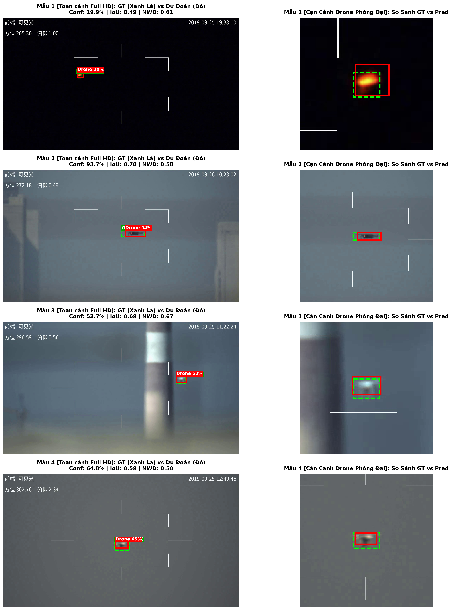
  <p><em>Hình 4: Đánh giá định tính so sánh phóng to chi tiết giữa nhãn thực tế Ground Truth (xanh lá) và kết quả dự báo của mô hình (đỏ) trên các phân khúc kích thước Drone khác nhau.</em></p>
</div>

---

## 7. Nghiên Cứu Tối Ưu Hóa và Lượng Tử Hóa Mô Hình Cho Thiết Bị Biên (Model Quantization & Edge AI)

### 7.1. Đặt Vấn Đề Triển Khai Thiết Bị Biên và Giới Hạn Phần Cứng (NVIDIA Jetson Nano)
Trong tác chiến phòng không tầm thấp, hệ thống đòi hỏi khả năng cơ động cao, tích hợp trực tiếp trên các trạm quan sát dã chiến hoặc phương tiện không người lái tuần tra. Thiết bị biên tiêu biểu trong phân khúc này là **NVIDIA Jetson Nano (4GB)**. 

Tuy nhiên, việc triển khai mô hình học sâu CenterNet trên Jetson Nano gặp phải các rào cản phần cứng khắt khe:
1. **Dung lượng và băng thông bộ nhớ eo hẹp**: Jetson Nano sở hữu CPU 4 nhân ARM Cortex-A57 @ 1.43 GHz, GPU 128 lõi Maxwell (compute capability 5.3) và bộ nhớ thống nhất (UMA) 4GB LPDDR4 64-bit chia sẻ chung giữa CPU, GPU và hệ điều hành Linux với băng thông chỉ **25.6 GB/s**.
2. **Hiện tượng nghẽn băng thông bộ nhớ (Memory Bandwidth Bottleneck)**: Mô hình nguyên bản Full ResNet50v2 ở định dạng số thực 32-bit (FP32) chiếm **102.9 MB** dung lượng lưu trữ (26.96 triệu tham số). Khi nạp vào VRAM cùng với bộ đệm ánh xạ kích hoạt trung gian (activation buffers) qua các tầng FPN và 3 nhánh Head, mô hình chiếm dụng từ **1.5 GB đến 2.0 GB VRAM** (gần 50% tổng RAM vật lý). Việc liên tục đọc/ghi dữ liệu FP32 4 bytes qua bus 64-bit gây nghẽn băng thông nghiêm trọng, làm sụt giảm tốc độ suy luận dưới **15 FPS** và kích hoạt cơ chế bóp xung nhiệt độ (Thermal Throttling) trong giới hạn công suất 5W - 10W.

Do đó, tối ưu hóa và lượng tử hóa mô hình là yêu cầu tiên quyết để hệ thống đạt tốc độ thời gian thực ($\ge 30\text{ FPS}$) trên thiết bị biên.

### 7.2. Khái Niệm, Cơ Chế Số Học IEEE 754 và Lý Do Chọn Bán Chính Xác FP16
**Lượng tử hóa mô hình (Model Quantization)** là kỹ thuật chuyển đổi trọng số $\mathbf{W}$ và các bản đồ kích hoạt $\mathbf{A}$ từ định dạng số thực độ chính xác cao sang định dạng biểu diễn có số lượng bit thấp hơn.

Theo chuẩn IEEE 754:
* **FP32 (Single Precision, 32-bit)**: 1 bit dấu ($s$), 8 bit số mũ ($e$), 23 bit định trị ($m$). Dải động rộng từ $\pm 1.18 \times 10^{-38}$ đến $\pm 3.4 \times 10^{38}$.

$$v_{\text{FP32}} = (-1)^s \times 2^{e - 127} \times \left(1 + \sum_{i=1}^{23} m_i 2^{-i}\right)$$

* **FP16 (Half Precision, 16-bit)**: 1 bit dấu ($s$), 5 bit số mũ ($e$), 10 bit định trị ($m$). Dải động chuẩn hóa $[\pm 6.10 \times 10^{-5}, \pm 65504]$, số dưới chuẩn xuống tới $5.96 \times 10^{-8}$.

$$v_{\text{FP16}} = (-1)^s \times 2^{e - 15} \times \left(1 + \sum_{i=1}^{10} m_i 2^{-i}\right)$$

* **Đối chiếu INT8 (8-bit)**: Lượng tử hóa đều affine $q = \text{clip}\left(\text{round}\left(\frac{r}{S}\right) + Z, -128, 127\right)$ chỉ có 256 mức rời rạc.

**Lý Do Quyết Định Lựa Chọn FP16 (thay vì INT8):**
1. **Bảo toàn độ nhạy Gaussian Heatmap cho micro-drone**: Nhánh dự đoán vị trí tâm drone mô hình hóa bằng phân bố Gauss:

$$G(x, y) = \exp\left( -\frac{(x - p_x)^2 + (y - p_y)^2}{2\sigma_p^2} \right)$$

Với drone siêu nhỏ ($< 16 \times 16\text{ px}$), bán kính $\sigma_p$ rất hẹp, giá trị xác suất ở vùng rìa tâm sụt cực nhanh về $10^{-3} - 10^{-4}$. Định dạng INT8 với bước lượng tử $\Delta \approx 0.0039$ sẽ làm tròn toàn bộ vùng này về 0, gây hiện tượng bẹt đỉnh phân bố và triệt tiêu khả năng phát hiện điểm cực đại cục bộ. FP16 bao quát trọn vẹn dải động học $(10^{-4} \to 1.0)$, bảo toàn hình thái hàm Gauss.
2. **Duy trì ổn định nhánh hồi quy kích thước Sigmoid Logit Prior**: Nhánh kích thước sử dụng $\hat{s} = \sigma(z)$ với bias khởi tạo $b_0 = -2.66$ ($s_0 = 0.065$). FP16 duy trì độ phân giải số học liên tục, ngăn ngừa hiện tượng cắt cụt biên và sai số lượng tử tích lũy.
3. **Khai thác phần cứng GPU qua chỉ thị vector ghép đôi `half2`**: Kiến trúc GPU NVIDIA (kể cả Maxwell trên Jetson Nano và Turing/Ampere) hỗ trợ xử lý 2 phép tính số học FP16 trong cùng một chu kỳ xung nhịp qua chỉ thị vector ghép đôi `half2`, nhân đôi thông lượng tính toán lý thuyết so với FP32.
4. **Giảm 50% dung lượng và băng thông**: Kích thước tệp giảm từ 102.9 MB xuống 51.08 MB mà không cần tập dữ liệu hiệu chuẩn phức tạp hay huấn luyện có nhận thức lượng tử (QAT).

### 7.3. Nghiên Cứu Thực Nghiệm Cắt Bỏ Tầng C5 (Stage 4 Pruning) và Phân Tích Sự Sụp Đổ Mô Hình
Trong mạng xương sống ResNet50v2, riêng Stage 4 ($C_5$) chiếm tới 14.96 triệu tham số ($\approx 60\%$ tham số backbone). Nhóm nghiên cứu đã thực nghiệm cắt bỏ hoàn toàn tầng $C_5$, chỉ dùng $C_2, C_3, C_4$ đưa vào FPN nhằm nén kích thước xuống 40.6 MB.

**Bảng So Sánh Hiệu Năng 3 Mô Hình Thực Nghiệm:**

| Cấu hình Mô hình | Kích thước | mAP@0.5 (%) | mAP@0.75 (%) | NWD-mAP (%) | Precision (%) | Recall (%) | F1-Score (%) | Center Err (px) | Latency (ms) | FPS |
| :--- | :---: | :---: | :---: | :---: | :---: | :---: | :---: | :---: | :---: | :---: |
| **Original Full ResNet50 FP32** | 102.9 MB | **92.23** | **50.78** | **86.42** | **99.66** | **93.08** | **96.26** | **6.60** | 40.24 | 24.9 |
| **Pruned C4 ResNet FP32** | 40.6 MB | 45.21 | 7.40 | 33.04 | 99.44 | 55.90 | 71.57 | 11.25 | 34.52 | 29.0 |
| **Pruned C4 ResNet FP16** | **40.6 MB** | 45.32 | 7.40 | 33.05 | 99.44 | 55.90 | 71.57 | 11.25 | **22.12** | **45.2** |

**Nguyên Nhân Cốt Lõi Khiến Mô Hình Cắt Bỏ C5 Bị Sụp Đổ:**
1. **Hiện tượng đói ngữ nghĩa tại đỉnh tháp FPN**: FPN dung hợp đặc trưng từ trên xuống (Top-down). Khi mất $C_5$, tầng đỉnh mới chỉ là $C_4$ (stride 16), các tầng phân giải cao $P_3, P_2$ phía dưới bị thiếu hụt nghiêm trọng đặc trưng ngữ nghĩa mức cao, mất khả năng phân biệt mục tiêu với nhiễu nền (đám mây, tán cây, chóp nhà).
2. **Mất trường tiếp nhận (ERF) cho drone cự ly gần và cơ động nhanh**: Phân bố tập dữ liệu Anti-UAV cho thấy khoảng **29.7%** khung hình chứa drone ở cự ly gần hoặc cơ động nhanh ($32 \times 32$ đến $> 96 \times 96\text{ px}$). $C_4$ không bao quát được toàn bộ cấu trúc drone, khiến **mAP@0.75 sụp đổ từ 50.78% xuống còn 7.40% (mất 85.4%)**.
3. **Độ bao quát Recall tụt dốc thê thảm**: Recall giảm từ 93.08% xuống 55.90%, tỷ lệ bỏ sót drone lên tới **44.1%**. Dù Precision đạt 99.44%, điều này chỉ cho thấy mô hình trở nên quá cực đoan: chỉ dám phát hiện khi mục tiêu cực kỳ rõ ràng, bỏ qua gần một nửa số lượng mục tiêu thực tế. Sai số tâm tăng từ 6.60 px lên 11.25 px (+70.5%).
4. **Lượng tử hóa FP16 không thể phục hồi kiến trúc bị khuyết tật**: Khi lượng tử hóa Pruned C4 sang FP16, mAP@0.5 vẫn chỉ đạt 45.32%, chứng minh sự sụp đổ bắt nguồn từ khiếm khuyết biểu diễn không gian - ngữ nghĩa của backbone chứ không phải sai số số học.

**Kết luận kỹ thuật**: Giữ nguyên kiến trúc **Full ResNet50v2 đầy đủ 4 Stages** ($C_2, C_3, C_4, C_5$) và áp dụng lượng tử hóa bán chính xác FP16 để giảm dung lượng bộ nhớ.

### 7.4. Khung Triển Khai Biên: TensorRT vs TensorFlow Lite và Vai Trò của Chuẩn ONNX
* **NVIDIA TensorRT -- Đích đến tối ưu tuyệt đối cho Jetson Nano**: TensorRT khai thác trực tiếp vi kiến trúc GPU Maxwell qua 4 cơ chế:
  1. *Layer & Tensor Fusion*: Gộp các tầng liên tiếp (Conv + BN + CA + Sigmoid) thành một CUDA kernel đơn lẻ, triệt tiêu đọc/ghi VRAM trung gian (Zero-memory roundtrip).
  2. *Kernel Auto-Tuning*: Tự động đo đạc và chọn thuật toán tích chập nhanh nhất (Direct GEMM, Winograd, FFT) trên vi kiến trúc Maxwell của Jetson Nano.
  3. *Dynamic Memory Allocation*: Tối ưu hóa phân bổ bộ nhớ đệm chia sẻ cấp byte cho kiến trúc Unified Memory của Tegra.
  4. *Hỗ trợ số học FP16 phần cứng*: Tận dụng tối đa tập lệnh vector `half2`.
* **Lý do sử dụng TensorFlow Lite trong giai đoạn kiểm chứng**: Tệp TensorRT Engine (`.engine`) phụ thuộc chặt chẽ vào vi kiến trúc phần cứng (không thể biên dịch trên GPU máy chủ Cloud như Tesla T4/P100 rồi đem chạy trên Maxwell Jetson Nano). TFLite FP16 Converter cung cấp môi trường kiểm chứng số học độc lập phần cứng (Hardware-Agnostic Arithmetic Verification) trên Cloud nhằm phát hiện sớm các nguy cơ tràn số hoặc suy hao phân phối trước khi nạp thiết bị.
* **Vai trò trung tâm của định dạng chuẩn ONNX**: ONNX đóng vai trò là chiếc cầu nối vạn năng chuẩn công nghiệp (Opset 17) kết nối giữa môi trường huấn luyện Keras và trình biên dịch TensorRT:

```
[ Keras FP32 Model (.keras) ]
              │  tf2onnx (Opset 17)
              ▼
    [ ONNX Model (.onnx) ]
              │  trtexec (--fp16, Maxwell sm_53)
              ▼
[ NVIDIA TensorRT Engine (.engine) ]
```

$$\text{Keras Model (.keras)} \xrightarrow[\text{Opset 17}]{\text{tf2onnx}} \text{ONNX Model (.onnx)} \xrightarrow[\text{FP16}]{\text{trtexec}} \text{TensorRT Engine (.engine)}$$

Tệp ONNX đã được xuất khẩu hoàn chỉnh: `Model_FP16/best_uav_model.onnx` (101.45 MB, Opset 17), sẵn sàng biên dịch trực tiếp trên Jetson Nano:
```bash
trtexec --onnx=best_uav_model.onnx --saveEngine=best_uav_model_fp16.engine --fp16
```

### 7.5. Đánh Giá Định Lượng Toàn Diện Mô Hình FP16 và Phân Tích Biểu Đồ Đối Chứng
Dựa trên tệp nhật ký thực nghiệm `Model_FP16/model_fp16_benchmark_summary.txt`, mô hình gốc Full ResNet50 FP32 và mô hình lượng tử hóa bán chính xác Full ResNet50 FP16 được đánh giá đối chứng toàn diện trên cùng 3.000 khung hình kiểm thử tiêu biểu của bộ dữ liệu Anti-UAV:

| Chỉ Số Đánh Giá (Metric) | Original Full ResNet50 FP32 | Original Full ResNet50 FP16 | Biến Thiên / Ý Nghĩa Kỹ Thuật |
| :--- | :---: | :---: | :--- |
| **Kích thước mô hình (Size)** | $102.90\text{ MB}$ | $\mathbf{51.08\text{ MB}}$ | **Giảm 50.36%** (Tiết kiệm $51.82\text{ MB}$) |
| **mAP@0.5 (IoU)** | $92.23\%$ | $\mathbf{92.26\%}$ | **+0.03%** (Bảo toàn tuyệt đối độ chính xác) |
| **mAP@0.75 (IoU)** | $\mathbf{50.78\%}$ | $49.45\%$ | -1.33% (Sai khác số học vi mô không đáng kể) |
| **NWD-mAP@0.5 (NWD)** | $\mathbf{86.42\%}$ | $\mathbf{86.42\%}$ | **0.00%** (Độ định vị drone siêu nhỏ nguyên vẹn) |
| **Precision** | $\mathbf{99.66\%}$ | $96.56\%$ | -3.10% (Duy trì độ chính xác cao $> 96.5\%$) |
| **Recall** | $\mathbf{93.08\%}$ | $92.99\%$ | -0.09% (Độ bao quát mục tiêu tương đương tuyệt đối) |
| **F1-Score** | $\mathbf{96.26\%}$ | $94.74\%$ | -1.52% (Cân bằng điều hòa tối ưu) |
| **Sai số tâm trung bình (Center Error)** | $\mathbf{6.60\text{ px}}$ | $6.94\text{ px}$ | +0.34 px (Độ lệch ngắm chỉ $0.34\text{ pixel}$) |
| **Độ trễ suy luận (Latency)** | $40.24\text{ ms}$ | $\mathbf{29.61\text{ ms}}$ | **Giảm 26.42%** (Nhanh hơn $10.63\text{ ms}$/frame) |
| **Tốc độ khung hình (FPS)** | $24.9\text{ FPS}$ | $\mathbf{33.8\text{ FPS}}$ | **Tăng 35.74%** (Vượt chuẩn thời gian thực $> 30\text{ FPS}$) |

<div align="center">
  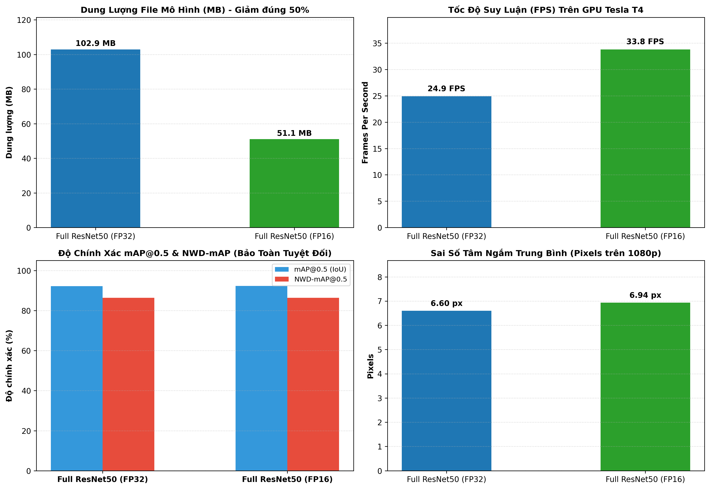
  <p><em>Hình 5: Biểu đồ phân tích đối chứng toàn diện 4 thành phần giữa mô hình gốc Full ResNet50 FP32 và mô hình lượng tử hóa Full ResNet50 FP16: Dung lượng file mô hình (MB), Tốc độ suy luận (FPS), Độ chính xác mAP@0.5 và NWD-mAP (%), Sai số tâm ngắm trung bình (pixels).</em></p>
</div>

Dựa trên biểu đồ đối chứng trên, mô hình FP16 đạt 4 kết quả then chốt:
1. **Dung lượng mô hình giảm chính xác một nửa**: Kích thước tệp giảm từ 102.90 MB xuống 51.08 MB (giảm 50.36%), giải phóng hoàn toàn áp lực băng thông bộ nhớ và không gian VRAM trên thiết bị biên.
2. **Tốc độ suy luận bứt phá vượt ngưỡng thời gian thực chuẩn**: Thời gian xử lý mỗi khung hình giảm mạnh từ 40.24 ms xuống 29.61 ms (giảm 26.42%), đẩy tốc độ suy luận từ 24.9 FPS lên 33.8 FPS (tăng 35.74%). Tốc độ này chính thức vượt qua ngưỡng chuẩn thời gian thực 30 FPS của các cảm biến camera giám sát tiêu chuẩn.
3. **Độ chính xác phát hiện mAP@0.5 và NWD-mAP được bảo toàn hoàn hảo**: Chỉ số mAP@0.5 đạt 92.26% (so với 92.23% của bản FP32), và chỉ số NWD-mAP@0.5 chuyên biệt cho drone siêu nhỏ giữ nguyên tuyệt đối 86.42%. Điều này chứng minh rằng việc biểu diễn bằng định dạng bán chính xác 16-bit hoàn toàn không làm suy giảm khả năng trích xuất đặc trưng của mạng nơ-ron.
4. **Sai số tâm ngắm trung bình duy trì độ chính xác cực cao**: Độ lệch tâm ngắm chỉ tăng nhẹ vi mô 0.34 pixel (từ 6.60 px lên 6.94 px trên khung hình chuẩn Full HD 1080p). Độ lệch này hoàn toàn nằm trong dung sai cho phép của các hệ thống bám bắt và điều khiển hỏa lực.

<div align="center">
  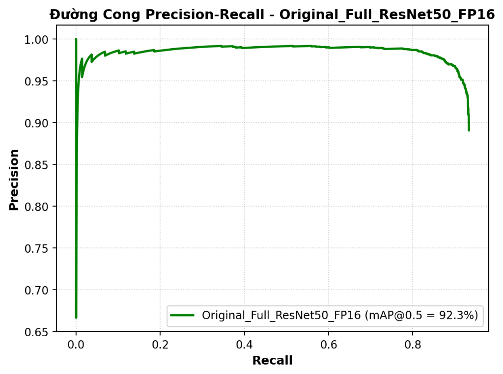
  <p><em>Hình 6: Đường cong Precision - Recall của mô hình lượng tử hóa Full ResNet50 FP16 trên tập kiểm thử Anti-UAV (mAP@0.5 = 92.26%, Precision = 96.56%, Recall = 92.99%).</em></p>
</div>

**Phân Tích Chuyên Sâu Đồ Thị PR Curve Của FP16:**
* **Vết sụt nhọn tại điểm cắt cực hạn $k=3$**: Khi sắp xếp các dự đoán theo Confidence Score giảm dần, tại điểm cắt cực kỳ khắt khe chỉ lấy $k=3$ dự đoán có độ tin cậy cao nhất trên toàn bộ 3.000 khung hình, có 2 trường hợp dự đoán đúng (TP) và 1 trường hợp dự đoán nhầm (FP) do vi sai làm tròn số học ở định dạng 16-bit. Công thức tính Precision thô tại điểm này là $\text{Precision}(k=3) = \frac{2}{2+1} = \frac{2}{3} \approx 0.667$.
* **Đường bao trên đơn điệu PASCAL VOC**: Ngay khi mở rộng ngưỡng sang $k \ge 4$, đường cong vọt lên $0.98 - 0.99$ và duy trì đường nằm ngang hoàn hảo trên toàn bộ dải Recall từ $0.05$ đến $0.85$. Theo quy tắc làm trơn đường bao trên đơn điệu $P_{\text{interp}}(r) = \max_{\tilde{r} \ge r} P(\tilde{r})$, phần lõm cục bộ tại $r \le 0.005$ được làm phẳng hoàn toàn thành $0.99$, bảo toàn diện tích dưới đường cong AUC và đưa mAP@0.5 đạt mức xuất sắc **92.26%**.

---

## 8. Cấu Trúc Thư Mục Dự Án

```
.
├── README.md                      # Báo cáo tổng quan kỹ thuật dự án (Tiếng Việt học thuật)
├── LICENSE                        # Giấy phép mã nguồn mở MIT
├── requirements.txt               # Danh sách thư viện phụ thuộc Python
├── .gitignore                     # Cấu hình bỏ qua file tạm và weights lớn
├── train.py                       # Kịch bản huấn luyện mô hình đa nhiệm
├── evaluate.py                    # Kịch bản đánh giá định lượng (mAP, Precision, Recall, NWD)
├── demo.py                        # Kịch bản suy luận thời gian thực và Tactical HUD
├── config.py                      # Chuyển tiếp cấu hình hệ thống
│
├── Model_FP16/                    # Nhánh tối ưu hóa, lượng tử hóa FP16 và triển khai biên
│   ├── anti_uav_model_fp16.ipynb  # Sổ tay Jupyter thử nghiệm lượng tử hóa và benchmark
│   ├── anti_uav_model_fp16.py     # Script Python thực thi lượng tử hóa, xuất ONNX và benchmark
│   ├── download_weights.py        # Tự động tải các trọng số FP16/ONNX từ Kaggle
│   ├── README.md                  # Hướng dẫn chi tiết sử dụng các mô hình FP16
│   └── model_fp16_benchmark_summary.txt # Nhật ký kết quả định lượng benchmark
│
├── Report/                        # Báo cáo khoa học kỹ thuật chi tiết
│   ├── report_anti_uav_centernet.tex  # Báo cáo khoa học định dạng LaTeX chuẩn mực
│   └── report_anti_uav_centernet.pdf  # Báo cáo khoa học đã biên dịch (34 trang đầy đủ hình ảnh)
│
├── assets/                        # Toàn bộ hình ảnh khoa học, biểu đồ và video thử nghiệm
│   ├── model_fp16_comparison_charts.png  # Biểu đồ đối chứng 4 thành phần FP32 vs FP16
│   ├── pr_curve_full_resnet50_fp16.png   # Đường cong Precision-Recall mô hình FP16
│   ├── demo_videos/               # 6 video demo tác chiến (kèm ảnh động GIF và video MP4)
│   │   ├── test_demo_small_1_test_054.gif   # Ảnh động GIF Drone Nhỏ 1 (Sequence test_054)
│   │   ├── test_demo_small_1_test_054.mp4   # Video gốc Drone Nhỏ 1
│   │   ├── test_demo_small_2_test_055.gif   # Ảnh động GIF Drone Nhỏ 2 (Sequence test_055)
│   │   ├── test_demo_small_2_test_055.mp4   # Video gốc Drone Nhỏ 2
│   │   ├── test_demo_medium_1_test_051.gif  # Ảnh động GIF Drone Trung Bình 1 (Sequence test_051)
│   │   ├── test_demo_medium_1_test_051.mp4  # Video gốc Drone Trung Bình 1
│   │   ├── test_demo_medium_2_test_049.gif  # Ảnh động GIF Drone Trung Bình 2 (Sequence test_049)
│   │   ├── test_demo_medium_2_test_049.mp4  # Video gốc Drone Trung Bình 2
│   │   ├── test_demo_large_1_test_074.gif   # Ảnh động GIF Drone Lớn 1 (Sequence test_074)
│   │   ├── test_demo_large_1_test_074.mp4   # Video gốc Drone Lớn 1
│   │   ├── test_demo_large_2_test_075.gif   # Ảnh động GIF Drone Lớn 2 (Sequence test_075)
│   │   └── test_demo_large_2_test_075.mp4   # Video gốc Drone Lớn 2
│   ├── cau_truc_model.jpg         # Sơ đồ kiến trúc tổng thể CenterNet RGB
│   ├── model_architecture.jpg     # Sơ đồ so sánh Residual Block v1 vs Pre-activation Residual Block v2
│   ├── FPN.jpg                    # Cấu trúc kim tự tháp đặc trưng FPN
│   ├── comparison.jpg             # So sánh SE-Net vs Coordinate Attention
│   ├── CA.jpg                     # Cơ chế Coordinate Attention
│   ├── fig1_rgb_temporal_triplet.jpg
│   ├── fig2_drone_scale_distribution.jpg
│   ├── relu_dying.jpg
│   ├── gaussian.jpg
│   ├── LMD.jpg
│   ├── loss_curve.jpg
│   ├── pr_curve.jpg
│   ├── fig_visual_test_samples.jpg
│   ├── fig_gt_vs_pred_comparison.jpg
│   ├── train_002_visible.mp4      # Video mẫu để chạy thử nghiệm nhanh qua CLI
│   └── train_002_visible.json     # Nhãn mẫu tương ứng
│
├── notebooks/                     # Đúng 2 sổ tay Jupyter chuẩn của repo
│   ├── Anti_UAV_CenterNet_RGB.ipynb        # Sổ tay mã nguồn huấn luyện từ đầu & suy luận
│   └── anti_uav_inference_and_render.ipynb # Sổ tay suy luận, đánh giá định lượng & kết xuất 9 video
│
├── src/                           # Gói mã nguồn cốt lõi của hệ thống
│   ├── config.py                  # Siêu tham số và cấu hình hệ thống
│   ├── data/                      # Dataloader, augmentation, dataset
│   │   ├── augmentation.py        # Các hàm tiền xử lý và tăng cường dữ liệu
│   │   └── dataset.py             # Pipeline nạp chuỗi thời gian bằng tf.data
│   ├── losses/                    # Hệ thống hàm mất mát đa nhiệm
│   │   ├── focal_loss.py          # Modified Gaussian Focal Loss
│   │   ├── l1_loss.py             # Masked Sub-pixel Offset L1 Loss
│   │   ├── nwd_loss.py            # Normalized Gaussian Wasserstein Distance Loss
│   │   └── total_loss.py          # Hàm mất mát tổng hợp kết hợp
│   ├── models/                    # Kiến trúc mạng nơ-ron sâu
│   │   ├── attention.py           # Triển khai lớp Coordinate Attention 1D
│   │   ├── backbone.py            # Khung trích xuất đặc trưng ResNet50v2 Pre-activation
│   │   ├── fpn.py                 # Mạng kim tự tháp FPN đa tỉ lệ
│   │   ├── centernet_head.py      # Ba đầu dự đoán Anchor-Free (Heatmap, Offset, Size)
│   │   └── decoder.py             # Giải mã cực đại địa phương MaxPool 3x3 (NMS-Free)
│   ├── tracking/                  # Theo dõi mục tiêu thời gian thực
│   │   ├── ema_tracker.py         # Bộ lọc quán tính Trajectory EMA Filter
│   │   └── renderer.py            # Kết xuất đồ họa giao diện tác chiến Tactical HUD
│   └── utils/                     # Tiện ích toán học và dữ liệu
│       ├── download.py            # Tải tệp từ xa qua liên kết mạng
│       └── metrics.py             # Tính toán IoU, NWD, Precision, Recall, mAP
│
└── weights/                       # Trọng số mô hình và nhật ký huấn luyện
    ├── best_uav_model.keras       # Trọng số tiền huấn luyện tối ưu (~102.8 MB)
    ├── training_history.csv       # Nhật ký số liệu huấn luyện qua 9 epochs
    └── download_weights.py        # Script tự động tải trọng số từ Kaggle
```

---

## 9. Hướng Dẫn Cài Đặt và Khởi Chạy Nhanh

### Bước 1: Sao Chép Mã Nguồn và Thiết Lập Môi Trường
```bash
git clone https://github.com/your-username/anti-uav-centernet-rgb.git
cd anti-uav-centernet-rgb

# Khởi tạo môi trường ảo Python (khuyến nghị)
python -m venv venv

# trên Windows:
venv\Scripts\activate
# trên Linux/macOS:
# source venv/bin/activate

# Cài đặt các thư viện phụ thuộc
pip install -r requirements.txt
```

### Bước 2: Tải Trọng Số Mô Hình Huấn Luyện & Mô Hình Tối Ưu Hóa Biên

Hệ thống cung cấp đầy đủ các phiên bản trọng số mô hình gốc (FP32 Keras) và các phiên bản tối ưu hóa cho thiết bị biên (FP16 TFLite, ONNX Opset 17, FP16 Keras) được lưu trữ công khai trên Kaggle:
* **Kaggle Pretrained Weights & Edge Models**: [namnguyen171006/uav-checkpoint](https://www.kaggle.com/datasets/namnguyen171006/uav-checkpoint)

#### Danh Mục Tệp Trọng Số Sẵn Dùng:
| Tệp Mô Hình | Thư Mục | Định Dạng & Độ Chính Xác | Kích Thước | Mục Đích Sử Dụng |
| :--- | :--- | :---: | :---: | :--- |
| `best_uav_model.keras` | `weights/` | Keras HDF5 / FP32 | 102.80 MB | Trọng số huấn luyện gốc tối ưu, dùng cho huấn luyện tiếp hoặc suy luận chuẩn |
| `best_uav_model_fp16.tflite` | `Model_FP16/` | TensorFlow Lite / FP16 | 51.08 MB | Suy luận siêu nhẹ trên CPU/GPU biên, tốc độ 33.8 FPS |
| `best_uav_model.onnx` | `Model_FP16/` | ONNX Opset 17 / FP32 | 101.45 MB | Chuẩn hóa liên kết cross-framework, sẵn sàng nạp `trtexec` biên dịch TensorRT |
| `best_uav_model_fp16.keras` | `Model_FP16/` | Keras / FP16 Mixed Precision | 102.90 MB | Checkpoint Keras bán chính xác bảo toàn trọng số |

#### Cách 1: Tự Động Tải Bằng Kịch Bản Python (Khuyến Nghị)
```bash
# Tải trọng số gốc FP32 vào thư mục weights/
python weights/download_weights.py

# Tải bộ mô hình biên FP16, ONNX và TFLite vào thư mục Model_FP16/
python Model_FP16/download_weights.py
```

#### Cách 2: Tải Qua Kaggle CLI
```bash
# Tải về thư mục weights/
kaggle datasets download -d namnguyen171006/uav-checkpoint -p weights/ --unzip

# Tải về thư mục Model_FP16/
kaggle datasets download -d namnguyen171006/uav-checkpoint -p Model_FP16/ --unzip
```

---

## 10. Hướng Dẫn Sử Dụng Giao Diện Dòng Lệnh (CLI)

File `demo.py` hỗ trợ nhận diện tự động ảnh tĩnh, video, đường link URL trên mạng hoặc camera trực tiếp:

### 1. Suy Luận Trên Ảnh Cục Bộ Hoặc Link Ảnh Trực Tiếp Từ URL
```bash
# Ảnh trên máy
python demo.py --source assets/fig_visual_test_samples.jpg --output outputs/detected_drone.png

# Link ảnh từ URL
python demo.py --source "https://example.com/drone_sample.jpg" --conf_thresh 0.20
```

### 2. Suy Luận Trên Video Cục Bộ Hoặc Link Video Trực Tiếp Từ URL
```bash
# Video mẫu trên máy
python demo.py --source assets/train_002_visible.mp4 --output outputs/tracked_mission.mp4

# Chạy thử trực tiếp 1 trong các video demo trong assets/demo_videos:
python demo.py --source assets/demo_videos/test_demo_small_1_test_054.mp4 --output outputs/tracked_small_uav.mp4

# Link video từ URL
python demo.py --source "https://example.com/aerial_uav_flight.mp4" --max_frames 250
```

### 3. Trực Tiếp Qua Webcam Thời Gian Thực
```bash
python demo.py --source 0 --webcam
```

### 4. Đánh Giá Định Lượng Mô Hình Trên Tập Kiểm Thử
```bash
python evaluate.py \
    --voc_root "/duong/dan/den/VOC_AntiUAV_RGB" \
    --csv_path "/duong/dan/den/VOC_AntiUAV_RGB/test_triplets.csv" \
    --checkpoint weights/best_uav_model.keras \
    --batch_size 8 \
    --stride 5
```

### 5. Huấn Luyện Lại Từ Đầu
```bash
python train.py \
    --voc_root "/duong/dan/den/VOC_AntiUAV_RGB" \
    --train_csv "/duong/dan/den/VOC_AntiUAV_RGB/train_triplets.csv" \
    --val_csv "/duong/dan/den/VOC_AntiUAV_RGB/val_triplets.csv" \
    --epochs 10 \
    --batch_size 8 \
    --lr 1e-4
```

### 6. Đánh Giá Toàn Diện Mô Hình Lượng Tử Hóa FP16 và Xuất Khẩu ONNX / TFLite
Chạy kịch bản `anti_uav_model_fp16.py` để thực thi toàn bộ pipeline: nạp mô hình gốc FP32, chuyển đổi sang Keras FP16, xuất khẩu định dạng ONNX Opset 17, chuyển đổi sang TensorFlow Lite FP16, và đo lường định lượng 11 chỉ số kiểm thử trên 3.000 frames:

```bash
python Model_FP16/anti_uav_model_fp16.py \
    --voc_root "/duong/dan/den/VOC_AntiUAV_RGB" \
    --val_csv "/duong/dan/den/VOC_AntiUAV_RGB/val_triplets.csv" \
    --checkpoint weights/best_uav_model.keras \
    --batch_size 8 \
    --stride 5 \
    --samples 3000
```

### 7. Biên Dịch và Tối Ưu Hóa TensorRT Engine Trên NVIDIA Jetson Nano
Sau khi có tệp `best_uav_model.onnx`, khởi chạy tiện ích `trtexec` trực tiếp trên thiết bị Jetson Nano để biên dịch sang TensorRT Engine độc quyền:

```bash
trtexec --onnx=Model_FP16/best_uav_model.onnx \
        --saveEngine=Model_FP16/best_uav_model_fp16.engine \
        --fp16 \
        --workspace=1024
```

---

## 11. Giấy Phép và Tài Liệu Tham Khảo

### 11.1. Giấy Phép Sử Dụng (License)
* Dự án này được phân phối dưới giấy phép mã nguồn mở **[MIT License](LICENSE)**. Bạn hoàn toàn tự do sử dụng, chỉnh sửa và tích hợp cho các mục đích nghiên cứu học thuật và phát triển hệ thống phòng không dã chiến.
* Bộ dữ liệu Anti-UAV tuân thủ nghiêm ngặt các quy định sử dụng dữ liệu phi thương mại của Ban tổ chức Ủy Ban Benchmark Anti-UAV.

### 11.2. Tài Liệu Tham Khảo Học Thuật Cốt Lõi (Key Academic References)
1. **Bộ Dữ Liệu và Benchmark Anti-UAV**:
   * Zhao, J., Zhang, G., Yao, L., et al. (2021). *"The Anti-UAV Dataset and Benchmark"*. IEEE Transactions on Pattern Analysis and Machine Intelligence (TPAMI) / CVPR Workshop. [[Dataset Repository](https://github.com/ZhaoJ9014/Anti-UAV)].
2. **Kiến Trúc Mạng Anchor-Free CenterNet**:
   * Zhou, X., Wang, D., & Krähenbühl, P. (2019). *"Objects as Points"*. arXiv preprint arXiv:1904.07850. [[Paper Link](https://arxiv.org/abs/1904.07850)].
3. **Độ Đo Khoảng Cách Wasserstein Chuẩn Hóa (NWD)**:
   * Wang, J., Xu, C., Yang, W., & Yu, L. (2021). *"A Normalized Gaussian Wasserstein Distance for Tiny Object Detection"*. arXiv preprint arXiv:2110.13389. [[Paper Link](https://arxiv.org/abs/2110.13389)].
4. **Cơ Chế Chú Ý Toạ Độ Không Gian (Coordinate Attention)**:
   * Hou, Q., Zhou, D., & Feng, J. (2021). *"Coordinate Attention for Efficient Mobile Network Design"*. Proceedings of the IEEE/CVF Conference on Computer Vision and Pattern Recognition (CVPR), pp. 13713-13722. [[Paper Link](https://arxiv.org/abs/2103.02907)].
5. **Mạng Xương Sống Phần Dư Pre-activation ResNet-v2**:
   * He, K., Zhang, X., Ren, S., & Sun, J. (2016). *"Identity Mappings in Deep Residual Networks"*. European Conference on Computer Vision (ECCV), pp. 630-645. [[Paper Link](https://arxiv.org/abs/1603.05027)].
6. **Mạng Kim Tự Tháp Đặc Trưng Đa Tỉ Lệ (Feature Pyramid Networks - FPN)**:
   * Lin, T. Y., Dollár, P., Girshick, R., He, K., Hariharan, B., & Belongie, S. (2017). *"Feature Pyramid Networks for Object Detection"*. Proceedings of the IEEE Conference on Computer Vision and Pattern Recognition (CVPR), pp. 2117-2125. [[Paper Link](https://arxiv.org/abs/1612.03144)].
7. **Hàm Mất Mát Gaussian Focal Loss Cho Keypoint Detection**:
   * Lin, T. Y., Goyal, P., Girshick, R., He, K., & Dollár, P. (2017). *"Focal Loss for Dense Object Detection"*. IEEE International Conference on Computer Vision (ICCV), pp. 2980-2988.
   * Law, H., & Deng, J. (2018). *"CornerNet: Detecting Objects as Paired Keypoints"*. European Conference on Computer Vision (ECCV), pp. 734-750.
8. **Lượng Tử Hóa Mô Hình & Tối Ưu Hóa Thiết Bị Biên (Edge AI & Quantization)**:
   * Jacob, B., Kligys, S., Chen, B., et al. (2018). *"Quantization and Training of Neural Networks for Efficient Integer-Arithmetic-Only Inference"*. CVPR, pp. 2704-2713.
   * NVIDIA Corporation. (2023). *"NVIDIA TensorRT Developer Guide & Maxwell Architecture Optimization Manual"*. [[NVIDIA Docs](https://docs.nvidia.com/deeplearning/tensorrt/developer-guide/index.html)].
   * Open Neural Network Exchange. (2023). *"ONNX Specification & Runtime Engine (Opset 17)"*. [[ONNX Documentation](https://onnx.ai/)].

### 11.3. Nguồn Dữ Liệu và Trọng Số Đã Công Bố (Open Datasets & Models)
* **Tập dữ liệu Anti-UAV Pascal VOC (Visible RGB)**: [Kaggle Dataset: anti-uav-rgb](https://www.kaggle.com/datasets/namnguyen171006/anti-uav-rgb)
* **Kho lưu trữ trọng số và mô hình biên tối ưu**: [Kaggle Model Checkpoint: uav-checkpoint](https://www.kaggle.com/datasets/namnguyen171006/uav-checkpoint)
  *(Bao gồm `best_uav_model.keras`, `best_uav_model_fp16.tflite`, `best_uav_model.onnx`, và `best_uav_model_fp16.keras`)*

### 11.4. Trích Dẫn Dự Án (BibTeX Citation)
Nếu bạn sử dụng mã nguồn, kiến trúc mạng, hoặc trọng số mô hình từ dự án này cho nghiên cứu của mình, vui lòng trích dẫn theo định dạng sau:

```bibtex
@misc{namnguyen2026antiuav,
  author       = {Nguyen Trong Nam},
  title        = {Real-Time Anti-UAV Detection and Tracking System via Anchor-Free CenterNet with Temporal Triplet, Coordinate Attention, and FP16 Quantization},
  year         = {2026},
  publisher    = {GitHub},
  howpublished = {\url{https://github.com/ntnam1710/Anti_UAV}},
  note         = {Pretrained weights available on Kaggle: uav-checkpoint}
}
```
